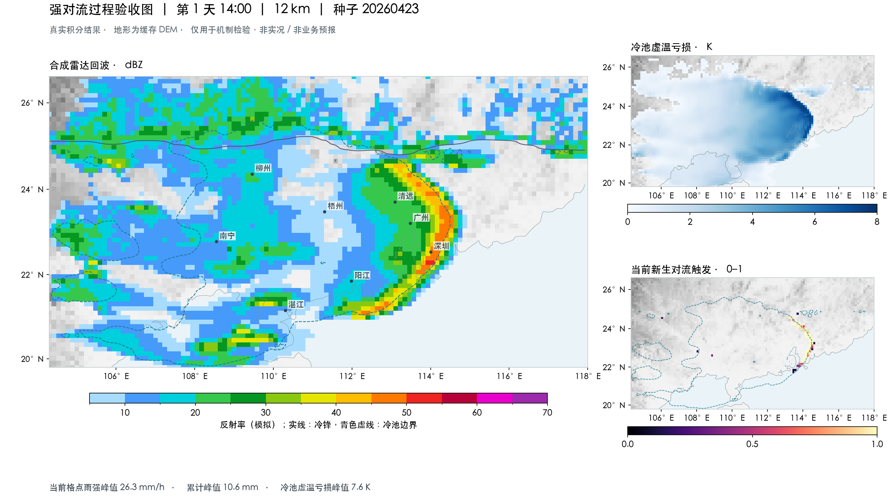

# StormSim 1.1 Astra：本轮交付记录

> 此文件归档前阶段 3.9.2 的结果。后续用户批准低分辨率整轮测试并恢复 Sol，当前内核为 3.9.4，两版入口已开放；最新结果见 [Sol 1.1 验收记录](ACCEPTANCE_SOL_1_1.md)。不将下述旧源码摘要当作新版实测。

产品版本 **1.1 Astra**，页面资源 `4.1.0`，最终物理内核 `3.9.2-resolved-coldpool-head`。Sol 文件和旧计算分支保留，公开入口及超时推荐隐藏；根目录 `.nojekyll` 已保留。未提交或推送 GitHub。

本轮到此收尾，不再追加计算。按用户要求取消 6 km 验证，其中止片段不计入以下结果。

## 已完成的完整过程

共完成七轮真实地形 **12 km / 72 h** 过程：两轮 3.9.0 基线、两轮 3.9.1 中间方案，以及三轮最终 3.9.2。每轮采用页面相同的种子环境抽样器，30 分钟采样诊断。完整配置、源码摘要、区域锋面位置和基线数据见 [汇总 JSON](validation/astra-1.1-summary.json)。

最终版物理源码摘要（`core.py / numerics.py / thermo.py / coldpool.py`）：

`fe7dcf947829fe56d562930dd0175a429b0e1769b56572c1bae5ff40c126af1e`

| 随机种子 | 弯曲带状追踪时长 | 原直线 PCA 追踪时长 | 最大瞬时格点雨强 | 最大滚动一小时累计 | 72 h 最大累计 |
| --- | ---: | ---: | ---: | ---: | ---: |
| 20260421 | 5.5 h | 1.0 h | 29.47 mm/h | 9.16 mm | 140.44 mm |
| 20260422 | 4.0 h | 0.5 h | 42.61 mm/h | 10.74 mm | 172.43 mm |
| 20260423 | 7.0 h | 1.0 h | 31.98 mm/h | 10.06 mm | 92.93 mm |

各列为全域、全部采样时次的独立最大值，不一定来自同一位置或同一时刻。瞬时雨强超过 20 mm/h **不代表**一小时累计超过 20 mm。

原始最终版诊断：[种子 421](validation/final-421-12.json.gz)、[种子 422](validation/final-422-12.json.gz)、[种子 423](validation/final-423-12.json.gz)。均包含完整 0–72 h 样本、追踪记录和预算，非只保留最佳时刻。

三例最大水量相对残差约 `0.96–1.10 × 10⁻⁷`，输送 CFL 不超过 0.45，冷池 CFL 不超过 0.40。锋面前 24–36 h 缓慢南移或波动；后续广西、广东均推进，包含同步及广东先行环境，而非固定广西先行。

## 验证范围及未达标项

- 122 项机制/数值单元测试通过，包含 Sol 旧数值一致性。最终版真实 Chrome/Pyodide 完成 12 km / 1 h / 7 帧计算、保存和自动首轮播放；56 组输送对照、3 类气块诊断、40 步 / 36 状态字段对照通过。地图、站点、播放、手机布局等前端回归通过。
- 72 h 过程在原生宿主完成，其中最终三轮采用仅供验证的原生输送/气块诊断加速实现；该实现与参考算子逐值及多步对照通过，未作为网站依赖发布。原生运行耗时包含并行负载，**不是浏览器 72 h 性能保证**。没有完成 6 km 验收。
- 新增弯曲带状指标用连通回波的测地长度及细长度补充原直线 PCA，二者分别报告。新指标更适合弓形回波，但不是业务飑线识别，也不能拿新指标时长与旧版 PCA 时长直接比较来宣称物理改善。三个种子不能代表全部环境。
- **雨量目标尚未全部满足**：最终三轮滚动一小时累计峰值仍只有约 9–11 mm；累计量也不是每个种子都比基线上升。不能宣称已稳定达到用户期望的飑线小时降水强度。
- 诊断阵风峰值约 49–55 m/s，仍需观测标定，不是可靠的业务风力预报。冷池内部新生触发并非所有时刻均为零，不能宣称后侧错误对流已完全消除。后部层云的最终形态和寿命仍需更多过程检验。
- 当前是降阶机制模拟；数值守恒、弯曲带状形态与单元测试通过，不等于达到完整三维云模式精度或现实预报技能。此次交付保留这些已知限制，不以视觉增色、强制延长回波或雨量倍乘掩盖。

## 实际积分样例

下图来自最终版种子 20260423 的 **第 6 小时**，不是整轮峰值合成图或真实天气截图。灰色底图为缓存 DEM。青色冷池轮廓仅用于此验收图，网页地图仍不显示冷池轮廓。

机制变更及测试说明见 [STORMSIM.md](STORMSIM.md)。
