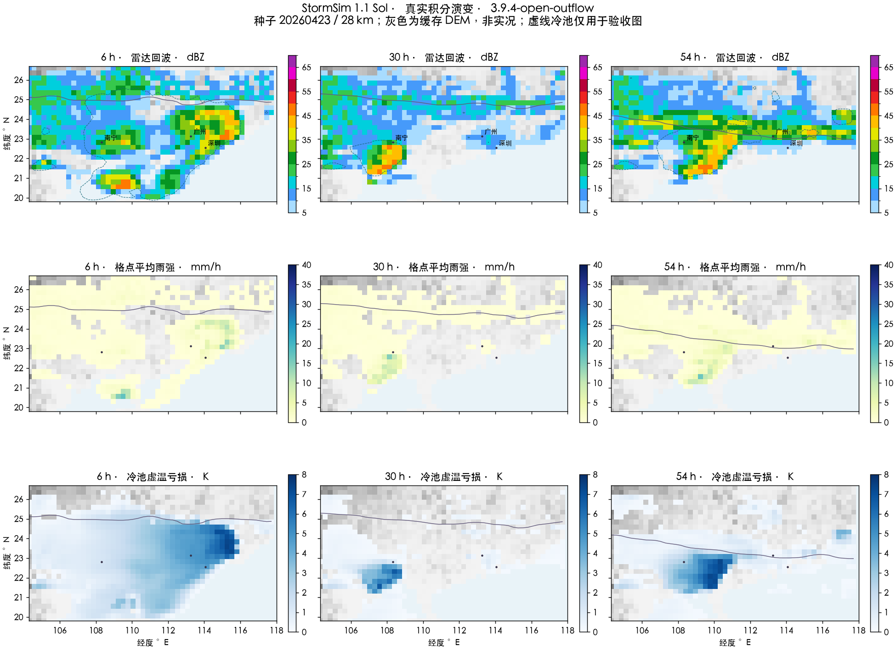

# StormSim 1.1 Sol：本地启动、演变与边界修正

当前内核 `3.9.4-open-outflow`，前端/Worker 脚本 `4.2.1`。Sol 已开放，Astra 保持 1.1；根目录 `.nojekyll` 保留，未推送 GitHub。

## 本地打开方式

不能从 `file://` 创建计算 Worker 并读取整套运行时。macOS 双击根目录 **`启动本地预览.command`**，或在项目目录执行 `python3 -m simulation.preview`。只用 Python 标准库，自动检查资源并打开 HTTP 页面；端口占用时自动避让，同项目可复用服务。页面会明确拦截错误打开方式，HTTP 下两版均载入 32 个站点。

## 实际完整计算耗时

本机 Chrome、真实 Pyodide，28 km / 14 层 / 72 h / 73 帧；包含初次依赖加载、完整物理积分、压缩及 IndexedDB 保存。地图在线瓦片在测试中关闭以隔离网络；不是所有设备、后台标签页或网络条件下的保证。最终例运行期间还有原生 Sol 诊断，耗时不是隔离性能实验。

| 种子 | 内核阶段 | 点击开始至保存完成 | 水量最大相对残差 |
| --- | --- | ---: | ---: |
| 20260421 | 3.9.3，中间版 | 280.763 s | 1.00×10⁻⁷ |
| 20260422 | 3.9.3，中间版 | 280.001 s | 1.73×10⁻⁷ |
| 20260423 | **3.9.4，最终边界修正版** | **259.197 s（4 分 19 秒）** | **1.06×10⁻⁷** |

此前新版物理的 24 km 试验到第 66 小时已用 336.9 秒，并在 360 秒测试超时；该次**未完成、不计入整轮通过**。因此采用 28 km，而非引用旧 Sol 1.0 的成绩。没有降低层数、强行扩大内部时间步、删除微物理或加快播放冒充计算提速。

原始浏览器记录：[421](validation/sol-1.1-421-browser.json)、[422](validation/sol-1.1-422-browser.json)、[最终 423](validation/sol-1.1-final-browser.json)。最终例的 [73 个真实显示场](validation/sol-1.1-final-browser-fields.json.gz) 一并保留。第一例另实际连续开始两次新一小时实验，种子与背景环境均重新生成。

## Sol 的形成、演化及局限

按用户后续要求，不再运行 Astra 天气过程；最终阶段完整过程只跑 Sol。原生同内核 Sol 另保存逐小时机制诊断：[完整过程](validation/sol-1.1-final-process.json.gz)。该运行和浏览器运行分别记录，不把原生耗时当成浏览器耗时。

- 最终种子 423 的首轮弯曲带状强降水回波可连续追踪 **第 2–7 小时，共 5 h**，最长带状尺度约 455 km；第 30–32 h、第 53–55 h 还有重新组织的带状回波。此追踪为实验性几何诊断，并非业务飑线分类。
- 冷池随降水产生并扩展，强回波随前缘发展；失去补给后衰减，后续环境恢复后可再次触发。广西/广东锋面前 12 h 分别仅南移约 4/7 km，后段两省均南下，没有固定只让广西先动。
- 原生最终例格点瞬时雨强峰值约 21.55 mm/h，滚动一小时峰值约 8.82 mm、最大累计约 80.83 mm；浏览器最终例瞬时峰值约 19.74 mm/h、最大累计约 81.05 mm。瞬时雨强与一小时累计不能混用，原生/WASM 的后期非线性结果不承诺逐格相同。
- **并未证明“相比 Astra 完全没有明显退化”**：28 km 会损失狭窄对流核、线性细节、海岸和山地效应。只用已有 Astra 3.9.2 快照、未重跑的 [共尺度静态参照](validation/sol-1.1-reference-comparison.json) 未通过全部预设容差，尤其部分时次的带状尺度；且参考内核与最终版不同，不能当作严格同版本优劣结论。保留失败记录，不用五分钟通过代替形态保真通过。
- 首小时强降水目标与部分后侧触发误差仍未全部解决，阵风也只是未经业务标定的参数化诊断。Sol 适合低成本过程实验，不等价于 Astra，更不是业务预报。

下图来自最终原生 Sol 的实际第 6/30/54 小时，未人为补线、增色或增加雨量。网页仍不显示冷池轮廓；虚线仅为验收图诊断。灰色底图为缓存 DEM，不是卫星底图缺失的替代承诺。



## 地图边缘问题的修正

1. **数值边界**：MUSCL 限制器原来在出流端仍读取固定外部温湿度，违反自由出流假设，制造非物理边缘斜率。Python 与浏览器融合算子现在都按法向风判断入/出流：外部值只供入流；出流采用内部零梯度延伸。受控测试验证改变出流外部温湿度不再影响内部结果，入流仍补给真实水汽，雨团可正常移出。
2. **显示边界**：最外侧格点原本延伸半格到声明的计算域外。现在这些像素透明表示“无数据”，不再重复绘制边缘天气。合成显示测试在 Astra/Sol 两页验证域外透明，同时域内 0.5 mm/h 小雨全部保留；没有在内核删除边缘降水或给地图内侧加无雨遮罩。
3. **地形配准**：旧 DEM 按数组首尾拉伸，不同分辨率的最后一个经纬度并不相同，导致海岸/山地移位。现在按实际模型坐标双线性取样，缓存中心覆盖以外采用最近边界值。解析坡面测试覆盖 6/12/28 km。

边界问题不意味着所有靠边的小雨都是错误。受控数值与像素缺陷已修正，但域内真实的锋面/层云降水仍然允许存在，不能宣称从此四条边永不下雨。

本阶段受控测试 70 项通过（边界 5、前锋/云 9、Sol 6、冷池 16、层云 13、冻结降水 6、高阶冷池 4、雨量/阵风 6、本地预览 5）。最终真实 WASM 的 56 组输送逐值一致、3 类气块诊断一致；此项按要求不运行模型步。另通过两页域外栅格、Sol 站点鼠标/触屏/键盘、文件打开方式、超时推荐与切换的界面回归。

复现 Sol 机制检查（不需要计算 Astra）：

```sh
python -m simulation.resolution_quality run --seed 20260423 --grid-km 28 --hours 72 --output /tmp/sol-quality-new
python -m unittest discover -s tests -p test_open_boundaries.py
node tests/benchmark_stormsim_sol.cjs
```

输出目录须为新目录；浏览器测试需要 Playwright 与 Chrome。原生诊断需 NumPy/SciPy，绘制验收图额外需要 Matplotlib；访客网页不需要安装这些本机包。
