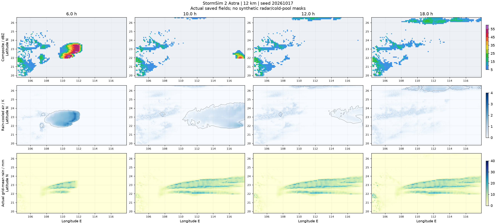

# StormSim 2：残留回波、南北范围与冷锋弯曲

内核 `4.5.0-finite-outflow-front-shape`，缓存标记 `5.5.0`。产品名保持 StormSim 2。最终源码 SHA-256：`2d301e86e9c17f443fb24e6177a69cf487b21caef338f7ed7cb0d84b7a88c23b`。

## 改动

1. **修正残留回波的来源**。同一实际飑线末期状态中，弱回波主要由 1–3 km 层的液态雨贡献，不是高空砧状冰云。原 `resolved_ascent` 把浅冷池残余辐合与天气尺度抬升一起沿约 3.5 km 高度衰减；厚约 50–150 m 的弱冷层因而能长期补充中低层凝结水。现在分开两种抬升：天气尺度抬升保留，地面扰动环流按实际邻近冷池头部深度限定强度和垂直伸展。成熟上升气流仍有独立、受实际水汽约束的质量通量。没有提高雷达显示门槛（仍为 5 dBZ），没有按时间、距离或冷池图形删除水物质；正常锋面雨、地形雨及仍有供给的层云雨继续存在。
2. **适度扩大南北起生机会**。有限辐合区半长由 80–115 km 调为 95–135 km，约增加 18%。这不是雷达线长硬上限或强制目标；北侧真实 CAPE/CIN、暖湿供给、冷池及地形仍决定哪些部分可以发展。母系统组织后仍关闭独立起生，不能靠后侧反复点火增加长度。
3. **冷锋真正响应地形与南风**。前方 20/40 km 的实际平滑 DEM 高差产生局地阻力，山口和山脊的推进不同；前方 120 km 实际天气尺度风的法向分量相对于情景参考入流改变局地推进速度，并包含沿锋平流。取样位于冷锋自身 70 km 风场影响之外，避免形成自加速反馈。沿锋平滑由 220 km / 3 h 改为 50 km / 12 h，保留天气尺度的地形与入流弯曲。地图仍绘制实际冷空气比例 0.5 等值线，不改成画好的曲线。外部锋面仍属降阶情景边界强迫，并非完整三维锋生求解。

不修改默认网格、层数、地图底图、站点、回放交互、站点降水守恒取样和阵风包络；`.nojekyll` 仍在根目录。

## 最终验证

- **225 项 Python 回归通过**，新增浅冷层不能抬升整层、真实天气尺度抬升不被误删、局地山脊阻力和实际入流变形检查。允许山地造成区域延迟，外部冷锋测试要求 96 h 内继续通过两省、移出南界，不再用严格 72 h 截止把它强行拉直。
- **Astra 12 km / 24 h 与 48 h**，两个独立种子从初始化完整积分；不是 Sol，也不声称默认 6 km 全过程已验证。48 h 样例仍有次日新的强对流过程。
- **真实 Chrome / Astra / 12 km / 3 h / 7 帧**通过，约 100.218 秒，源码 SHA 一致。Worker/WASM、保存、自动播放与结束后回放正常；这不是 48 h 浏览器耗时证明。

固定对照范围为 106–117°E、21–24.5°N；统计活动度低于 0.05 的非活跃格点，北部正常锋面雨不混入“暖区残留”。旧版为上轮 `4.4.0` 同种子、同网格的实际保存结果。

| 种子 / 时刻 | ≥5 dBZ 残留面积：旧 → 新 | 减少 | ≥15 dBZ 残留面积：旧 → 新 |
| --- | --- | --- | --- |
| 20261017 / 12 h | 109440 → 33264 km² | 69.6% | 7632 → 1728 km² |
| 20260423 / 12 h | 123984 → 43776 km² | 64.7% | 24192 → 4752 km² |
| 20260423 / 18 h | 228528 → 72432 km² | 68.3% | 64512 → 8208 km² |

| Astra 样例 | 时长 | 首轮主线最大南北跨度 | 格点雨强峰值 | 域内细网格五分钟雨量峰值 |
| --- | --- | --- | --- | --- |
| 20261017 | 24 h | 216 → 240 km | 103.80 mm/h | 26.99 mm |
| 20260423 | 48 h | 264 → 216 km | 89.32 mm/h | 22.74 mm |

**保留不一致结果**：第二个种子在取消虚假的深层残余抬升后，主线反而缩短；未宣称所有随机种子都变长。调整提供更宽的物理触发机会，但不强迫每条线达到固定长度。回波分段也保留在原始数据中。雨量是域内峰值，不代表所有观测站；细尺度取样不等于解析到同样空间分辨率。

两轮的阵风峰值均不超过 32 m/s，最大水量相对残差分别为 `1.90e-8`、`8.82e-8`。实际冷空气边界的弯曲检查读取原生 `air` 场，而不是只检查外部压力前缘。其数值场额外保存在验收报告旁的 `.fronts.npz`。

[最终验收报告](validation/stormsim-2-finite-acceptance.json) 的 10 项针对性检查通过；原始数据为 `validation/stormsim-2-finite-astra17.json`、`astra48.json` 及对应 `.json.npz`，真实浏览器报告为同前缀 `browser.json`。所有最终结果对应上述同一源码。开发阶段的旧状态敏感性测试仅用于查因，不作为最终独立天气过程证明。

部署仍需一起上传 `simulation/`、`assets/` 和两个模拟器 HTML，保留 `.nojekyll`。代码不会改写已保存的旧模拟，更新后应刷新并开始新一轮。
