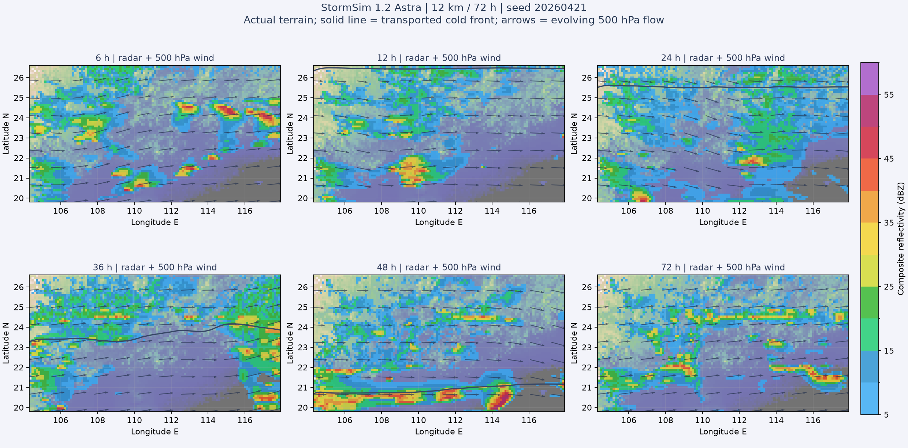

# StormSim 1.2 最终交付验收

> 本文为 1.2 / `3.14` 的历史记录；版本 2 已改变气团、CAPE、触发及雨量取样，当前验收见 [StormSim 2](STORMSIM_2.md)，不能将下面的旧成绩当作新版成绩。
>
> 后续勘误：1.2 离线站点核验使用双线性取样，但当时网页实际使用最近格点，两者并不一致。下表的 32 站雨量是离线取样值，不应当作 1.2 网页对应时刻的精确读数；版本 2 已统一网页与核验取样。

2026-10-16；产品 Astra / Sol 1.2，物理内核 `3.14.0-ice-number-budget`，前端及 Worker 缓存版本 `4.6.1`。仅修改本地项目，未自动上传 GitHub；按最终要求停止继续降配，Sol 保留 **28 km / 14 层**，未发布临时 32 km 试验。

## 验证范围与结论

以 **Astra** 为物理过程验收依据，完成最终同一源码的全域 12 km / 72 h（种子 20260421）、另一种子 48 h（20260422）、真实公开站点取样、云族消散及锋上对流试验。[机器验收表](validation/astra-1.2-final-acceptance.json) 所列 19 项过程门槛全部通过。未恢复此前取消的默认 6 km 全过程测试，不能将这些结果说成所有分辨率、随机种子或手机均已验证。

最终源码摘要（核心、实验配置及浏览器桥接）：

`c0d7684c68c1545c483a65eb12a43595bf57453f5350e43c9f5b50adc09c7489`

| 检查项 | 最终样本中的实际结果 |
| --- | --- |
| 冷锋进入、越岭加速、离域 | 初始冷空气在北界外；广西、广东均南下，24–36 h 位移相对 12–24 h 分别增至 2.34 / 1.77 倍；54 h 实际冷空气已覆盖南界，而非仅锋线消失 |
| 不再固定广西先行 | 第二种子广东段先行；两段随后共同推进并离域 |
| 分层风场 | 925、500、300 hPa 的 U、V 均随时间变化；500 hPa 的平均 V 分量范围约 7.79 m/s，浅槽随天气波动移动 |
| 带状组织 | 所采样强回波带最大南北跨度 276 km；弯曲带追踪最长 4 h，不再贯穿全域南北边界；这是工程追踪指标，不是业务形态技能分数 |
| 32 站离线取样 | 使用页面公开的 32 个站号及站表经纬度，不用城市中心替换国家站；离线采用双线性，但当时网页为最近格点，见上方勘误 |
| 单站与强核雨量 | 中山单次过程 23.50 mm，近 5 分钟峰值 8.96 mm；独立的区域点位近 5 分钟峰值 20.45 mm，强核命中的六小时窗口雨量中位数 30.67 mm |
| 阵风 | 两轮 Astra 采样最大阵风 24.68 / 26.07 m/s；中山同点阵风与持续风的最大增量 8.46 m/s，不用两个全域最大值相减冒充局地增量 |
| 旧层云消散 | 同一最终模型原生粒子数检查点停止新增对流凝结物后，旧对流冰云总量 4 h 剩 0.213%，8 h 剩 0.00126%；未使用按年龄、距离擦除回波的掩膜 |
| 实际锋上对流 | 真实地形、12 km、已进入区域的冷锋受控案例，实际积分形成最多 15 个锋区活跃对流格点；不只是允许触发的代码条件 |
| 水量闭合 | 上述过程最大水量相对残差约 1.71×10⁻⁷ |

站点不一定正好命中最强单体，不保证每个站都达到 20–40 mm；也不把区域峰值冒充中山或深圳的五分钟值。六小时强核窗口可能含多个单体，不能等同于每个站的一次飑线总量。部分极端核心可超过 20 mm/5 min，未人为封顶。环境锋区的新云雨仍允许存在，旧对流云族消散不等于强制所有弱回波消失；层状雨没有统一提高到强对流雨强。

## 本轮物理修正

- 外部天气尺度压力情景推动冷锋从北界外缓慢南下，越过实际 DEM 诊断的南岭区域山脊后平滑加速，继续出南界；沿锋压力调整避免广东段永久不动。冷空气从边界输送，不在域内重画示踪物或雷达雨带。保留锋上深对流，由实际抬升、暖侧能量、水汽和抑制共同决定。
- 925 hPa 急流轴线、强度及方向随日变化和天气扰动演变；500 hPa 有有限、倾斜、移动的浅槽及配套槽前上升/槽后下沉；300 hPa 急流随波动摆动。保留向北递减的可用 CAPE，不直接限制回波长度或南支槽宽度。
- 实际温湿廓线已计入的干化与加热不再被可用能量账本重复扣除；容量与消耗共同输送，保留飑后稳定化记忆，不能靠切换 MU 来源层清零。云增长、衰减改用云层穿越时间，降水从真实水物质与供给储库扣除，不乘显示倍数。
- 冰云增加粒子数输送，质量和粒子数采用一致载体通量；稀释不会让幸存冰粒错误缩小、越落越慢。水汽沉积受真实粒子表面积和扩散/热阻限制，聚合、升华、融化、扫掠与沉降共同退出旧云，不给极微量冰云固定整格凝结源。
- 普通湍流阵风与对流下击暴流分开，加入粗糙度、稳定度和地面摩擦；有限动量下传扣除高处动量，避免重复叠加已解析冷池风和理想下沉速度。没有为让测试通过而设置全局硬风速上限。

这些是降阶模型闭合，不是完整三维锋生、P3 微物理或业务校准；近地风代表最低约 30 m 层，不宣称严格 WMO 10 m 持续风/3 秒阵风精度。参考机制：[华南飑线个例](https://journals.ametsoc.org/view/journals/atsc/69/4/jas-d-11-0121.1.xml)、[预测粒子属性与质量/数浓度](https://journals.ametsoc.org/view/journals/atsc/72/1/jas-d-14-0065.1.xml)、[一致沉降输送](https://journals.ametsoc.org/abstract/journals/atsc/67/9/2010jas3341.1.xml)、[ECMWF 对流阵风参数化](https://www.ecmwf.int/en/elibrary/80227-parametrization-convective-gusts)。参考文献提供机制依据，不代表本项目系数已得到它们标定。

## 浏览器与回归

- 184 项 Python 单元/受控回归全部通过：179 项在普通环境通过，另 5 项预览服务测试因沙箱禁止绑定端口首次未执行，开放本机回环端口后单独复测全部通过。包含水量、冷池多示踪物、CAPE 消耗、冰云粒子数、紧凑浮点体积及 Sol 设置不影响 Astra 的隔离检查。
- 真实 Chrome + Astra Worker + Pyodide：12 km / 3 h / 7 帧，约 81.93 秒，实际载入 `synoptic.py`，三维场、925/500/300 风、五分钟降水及阵风字段完整；水量残差约 4.89×10⁻¹⁰。开始锁定、完成后自动播放、首轮结束才开放回放均通过。整轮物理过程另用原生 Python 验证，不把这个短网页测试冒充浏览器 72 h 测试。
- WebKit / iPhone 13 视口：真实 Astra 12 km 紧凑模式完成首帧持久保存并推进至 2.5%，无初始化错误，随后主动停止；这是 Safari 引擎检查，不等于实体 iPhone 完整 72 h 验证。
- 无天气积分的页面回归覆盖两版入口、ETA 提示、取消/新种子、子目录、32 站、触屏与键盘选站、SVG 保持、拖图不误选、本地 HTTP 与 `file://` 指引、地图边缘及零雨量显示。
- Sol 28 km 真实浏览器 72 h / 73 帧：功能、预算与回放通过，实测 **381.464 秒**，没有通过原先 300 秒性能断言。按最终要求不再压低精度，保留此结果，不沿用旧版五分钟成绩。`development/tests/benchmark_stormsim_sol.cjs` 仍保留原性能目标，运行它可能因超时目标返回非零，这不是隐瞒的功能错误。

## 交付证据

- [最终门槛与源码校验](validation/astra-1.2-final-acceptance.json)
- [Astra 72 h](validation/astra-1.2-final-72h.json) 及同名 `.json.npz` 场数据
- [另一种子 48 h](validation/astra-1.2-final-seed22.json) 及同名 `.json.npz` 场数据
- [32 站实际取样](validation/astra-1.2-final-stations.json)
- [原生粒子数旧云源切断诊断](validation/astra-1.2-final-source-off.json)
- [受控锋上对流案例](validation/astra-1.2-final-frontal.json)
- [真实 Astra 网页链路](validation/astra-1.2-final-browser.json)
- [Sol 当前浏览器性能](validation/sol-1.2-final-number-browser.json)

下图仅绘制已经计算完成的场，不重新积分。前期飑线和后期环境云雨不必在每个所选时次都呈相同形态。



复核既有结果（不重新模拟天气）：

```sh
python -m simulation.accept_delivery \
  --process simulation/validation/astra-1.2-final-72h.json \
  --stations simulation/validation/astra-1.2-final-stations.json \
  --wake simulation/validation/astra-1.2-final-source-off.json \
  --frontal simulation/validation/astra-1.2-final-frontal.json \
  --secondary simulation/validation/astra-1.2-final-seed22.json \
  --output /tmp/stormsim-final-acceptance.json
```

本地双击根目录 `development/launchers/启动本地预览.command`，不要直接以 `file://` 打开。上传时保留根目录 `.nojekyll`、完整 `simulation/`、`assets/` 和两个模拟器 HTML，尤其不要漏掉新模块 `simulation/synoptic.py`。检查点 pickle 不随网站发布。
