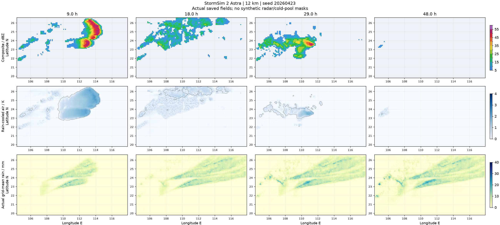
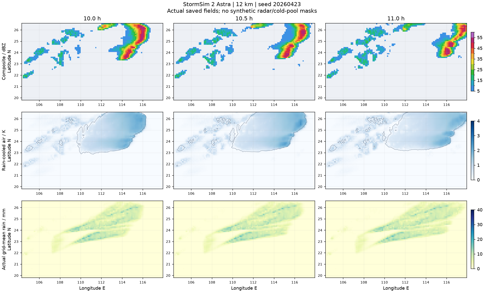

# StormSim 2：孟加拉湾槽前逐日对流过程

历史 `4.3.0` 验证记录，非当前交付。当前改动与证据见 [西风与暖区触发修复](WESTERLY_FIX_2.md)。

内核 `4.3.0-bay-trough-daily-episodes`，前端与 Worker 缓存标记 `5.3.0`。Astra 默认 6 km、Sol 28 km，均保留 14 层。本轮不修改地图、观测站、守恒站点降水取样或回放交互。

## 修复原因与实现

上一版把冷池/法向切变平衡平方，再乘风向对齐的平方；压力功又将这个乘积平方，同时入流要求乘积大于 0.15。几何损失被重复放大，斜交但有足够机械功的前缘无法再生。旧的有限局地浅槽离开后，缺少有效的首次抬升也使不少种子难以起生。

1. **槽底不再扫过华南**：独立种子将南支槽槽底置于 87–91°E、16–19°N，只有低速摆动。区域采用其宽广下游气流；500/300 hPa 风仍随位置和时间变化，保持西南分量。925 hPa 急流仍有时空和日变化。弱区域上升只作背景，不是全域自动触发器。此为用户指定的理想化情景，不代表所有华南飑线的共同实况配置。
2. **每轮一个有限起生区**：根据真实 CAPE/CIN/LFC 和地形，选出西部暖区的一处有利区域，施加一次随机强度/位置/时长的有限近地辐合过程。扰动风幅度 8–10 m/s，横向过渡尺度 18 km，沿线半长 80–115 km，持续 4–5 小时；这不是飑线寿命、速度或雨强。局地压力调整采用较快的中尺度时间尺度，避免两次 2 小时松弛把整个扰动过滤掉。对流仍须达到 LFC、克服 CIN，并消耗真实水汽和可用能量。
3. **禁止后侧伪再生，但允许第二天的新过程**：同一轮组织后关闭独立起生，后续需要临近已有对流、真实暖侧供给、正向入流、可用 CAPE 和有限冷池功。次日重新评估实际暖区与 CAPE/CIN/LFC，选择新的起生区/脉冲；没有“72 小时只准一次对流”的全程锁。新起生区必须无强冷池、冷池层厚小于 100 m、深冷空气比例小于 20%，且耗能记忆低于容量的 35%；这些资格也逐步作用于独立触发，不能把上一轮尾迹重新叫作新天气。没有清空冷池、重置 CAPE 或恢复水汽的操作。完全锋后稳定气团不会仅因换日就强行下雷暴。普通锋面/层状云雨仍自由形成、输送和消散，既有回波不被擦除。弱连接和衰减碎片不等于另一条独立起生飑线。
4. **恢复前缘抬升**：保留切变与边界法向的符号及对齐损失，但去掉重复的平衡平方、压力功再次平方以及过高的暖侧入流门槛。前缘的实际机械功只与 CIN 比较一次，有限深度仍限制高架源气块。冷池内部禁用“新鲜供给”的约束、CAPE 消耗记忆与地形阻力均保留。
5. **阵风略增强，上限 32 m/s**：下沉功进入未解析阵风的有效转换系数从 0.25 调整为 0.30。继续保留有限动量交换、稳定层阻挡、地面摩擦，以及已解析冷池风的能量扣除，不把高空急流直接复制到地面。32 m/s 是此教学情景的诊断上限，不是强制所有飑线达到的下限，也不是对真实极端阵风的普遍物理上限。

6. **长积分极微量冰云数值修复**：中间版本在约第 50 小时发现冰水趋近浮点下限时，残留冰晶数/有源输送矩没有同步减少，导致比值溢出。按已有 1 µm 最小冰晶半径约束可表示粒子数，融化/扫掠/升华改用真实剩余冰水比例更新来源矩；零载体不能携带孤立的粒子数或运动矩。没有把 NaN 替换为零，也没有删掉小于某阈值的冰水或雷达像素。增加 subnormal 冰水及数目守恒回归。

限制：每轮单一母系统是实验条件，不是由完整三维动力学证明的普遍规律。用户已澄清：第二天允许新一轮；被禁止的是第一轮尾迹错误形成第二条线。此前全程单轮候选不再是交付规则。仍为降阶分层模式；一个网格不等于有效解析精度。未恢复用户已取消的 6 km 整轮验证，不以 Sol 代替 Astra 验证。

## 验证

过程诊断程序：`python -m simulation.check_single_episode --seed 20260423 --hours 72 --output /tmp/astra.json`。逐积分步计算；每半小时报告触发与强对流，每小时保存真实数值场。主系统的弱连接可断成多个回波片段，因此同时保留所有分量的面积与尺度，不删去不理想结果。

当前源码 SHA-256：`1933f621afca50212533d85eb2bf7aad16e14e55dfb73123c8b20d24ceed129a`。本轮最终结果以 `validation/stormsim-2-daily-*` 为准；此前 `stormsim-2-bay-*` 仅为已撤销全程单轮规则的候选测试，不能冒充当前版本。

| Astra 12 km 样例 | 时长 | 首次起生 / 首次强对流 | 最大南北跨度 | 峰值阵风 | 域内细网格五分钟累计峰值 |
| --- | --- | --- | --- | --- | --- |
| 20260426 / 3 月 | 8 h | 2.5 / 4.5 h | 324 km | 28.34 m/s | 16.08 mm |
| 20260423 / 4 月 | 72 h | 3 / 6 h | 360 km | 29.52 m/s | 22.32 mm |
| 20260425 / 5 月 | 12 h | 1.5 / 2.5 h | 192 km | 30.12 m/s | 16.42 mm |

以上跨度来自强回波且有实际降水/对流活动的分量，不是整个层状云区的尺寸；细网格累计峰值不是所有真实站点都能达到的雨量。三轮域内细网格累计雨量最大值分别为 28.31、33.66、27.76 mm。

72 h 连续过程：第一轮在约 13 h 结束，18–24 h 没有新触发；次日起生中心从第一轮的约 `107.12°E / 22.39°N` 改为当时未耗竭暖区的约 `109.00°E / 22.28°N`。约 27 h 开始新的对流，28.5–29 h 形成新的强对流区域。第二轮较短，随后受推进的冷空气影响减弱；没有把它宣称为与首轮同等成熟、长寿命的飑线。第三天区域已转为稳定锋后气团，未强行造出雷暴。全程完成，未再出现 50 h 冰晶数溢出；最大水量相对残差为 `7.44e-8`。

**保留不理想/易误判结果**：4 月样例在 10.5 h 的强回波掩膜曾分成两个较大的分量，不能把“只有一个连通色块”称为已通过。追加同源码 11 h 定位检查，其 6/10/11 h 数值场与 72 h 前缀逐格相同。两个分量为南北分段，纬度不重叠，位于 10–11 h 同一推进前缘的时空连续范围内；相对线性时间插值前缘的最大偏差为 36 km（本检查容限 4 个 12 km 网格），不是后方新起一条平行线。严格强回波单分量诊断在验收 JSON 中保留为 `false`，并用独立起生区、时序和空间位置区分场次，未通过删回波或调雨量“过测”。

最终验收报告：[daily-acceptance.json](validation/stormsim-2-daily-acceptance.json)，11 项任务针对性检查通过。原始过程为同前缀 `astra-72h.json`、`astra26.json`、`astra25.json`、`fragment-inspection.json` 及对应 `.json.npz`；每个原始报告均记录源码 SHA 和全部分量。

- 216 项 Python 回归通过，包括新增的次日新过程、不能重置 CAPE/冷池、孤立环境冷斑不能播种，以及极微量冰晶/来源矩输送回归。
- 真实 Chrome：当前 Astra 12 km / 3 h / 7 帧，Worker/WASM、IndexedDB 保存、自动播放及结束后回放通过；实测 106.642 秒，水量相对残差 `-2.76e-11`。该浏览器测试不是 72 h 浏览器耗时证明。
- 真实 WebKit / iPhone 13 视口：当前源码成功保存首帧，初始化进度达到约 2.29%，无脚本异常；不是实体 iPhone 的整轮证明。
- 最终页面开始锁定、两版切换、站点、移动布局及缓存/数据解码检查通过。生产页面没有新增调试文字；代码更新后须开始新一轮，旧存档不会被改写。

## 参考与适用边界

- [Wu 等，2012，华南弓状飑线模拟](https://journals.ametsoc.org/view/journals/atsc/69/4/jas-d-11-0121.1.xml)：讨论冷池与法向低层切变、后部入流及局地弓段的关系。该案例包含局地浅槽，并不证明本次指定的孟加拉湾槽前情景适用于所有案例。
- [2005，南海季风试验飑线过程](https://journals.ametsoc.org/view/journals/mwre/133/6/mwr2933.1.xml)：描述环境西风、低层暖湿入流及冷池前缘辐合的重要作用。本实现仅借鉴机制，未用个例回波反演参数或同化实况。

部署时一起上传整个 `simulation/`、`assets/` 和模拟器 HTML，保留根目录 `.nojekyll`。代码更新不会改变已经保存的旧模拟；请开始新一轮。
