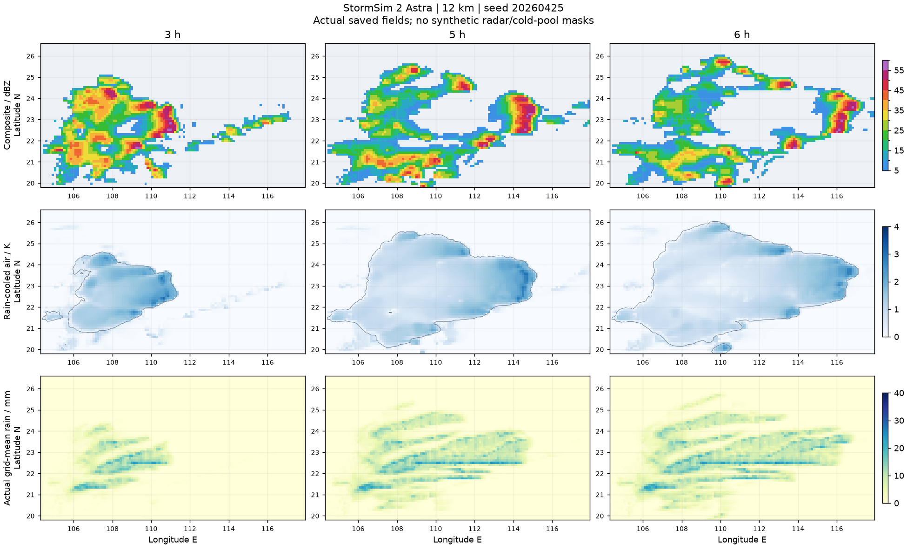
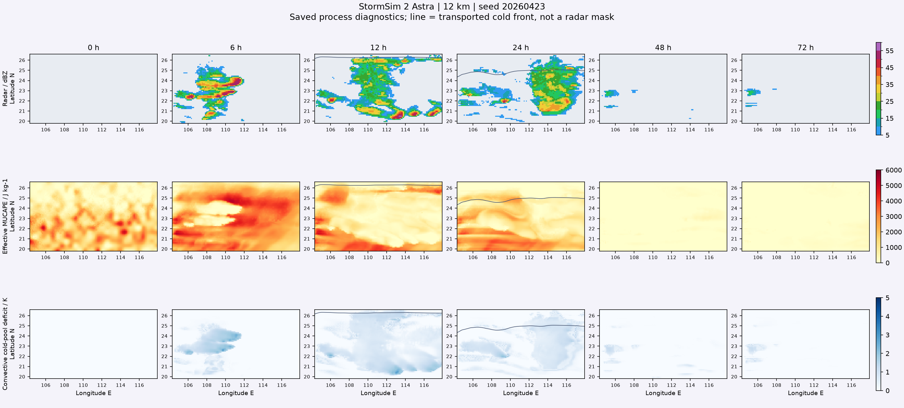

# StormSim 2：分段飑线、雨量与沿海山地

此为 4.1 前版记录；当前槽前单过程修复见 [SINGLE_EPISODE_2.md](SINGLE_EPISODE_2.md)，下列成绩不冒充当前版本。

内核 `4.1.0-density-current-inflow`，缓存 `5.1.0`。产品名继续为 StormSim 2。默认 Astra 桌面 6 km、移动端 12 km、14 层及 Sol 28 km 均未降配。本轮以实际 Astra 验证，不以 Sol 代替。无额外服务器、WRF 或在线地形依赖。

## 本轮修正

- **大弓与侧翼无差别再生**：RKW 使用冷池抬升深度两端的环境风差，不再拿层顶风减含急流的层平均风；暖侧整条风廓线按接收冷池的抬升深度取样，不能误用暖侧格点自身的冷池深度。去除冷池已有平移动量之外再次叠加的固有速度；沿边界切变很强、与实际头部不协调的斜侧翼不再获得与主下切变头部相同的组织效率。前缘形阻耗散向外的相对动量，不裁剪回波、冷池面积或指定地图方向；整体风场旋转时同样适用。
- **多强段、弱连接**：云团随机场具有物理尺度相关性和约 20 分钟的演变记忆。校正随机过程自身的数值扩散，保持统计强度和单位均值，不通过增大平均羽流潜在覆盖率来抬高降水。其作用进入真实羽流覆盖率与有限入流质量通量，因此强段会凝结更多水、产生更强降水和更大的局地冷却供给，弱连接仍可继续存在。并未给反射率贴噪声、规定弓段位置/数量，或强制每个种子都形成同一形态。
- **冷池体积**：除了蒸发负浮力，有限降水下沉气流也提供下降空气体积；同一冷量可以混入更多空气，而非只保留理想化的最冷部分。无蒸发供给时不凭空增加冷池；无新供给的湍流消散和 CAPE 消耗记忆保留。冷池不等于后部层云雨，未用冷池轮廓补画弱回波。
- **降水被重复限流**：羽流已经申请了 `密度×上升速度×覆盖率×时间步` 的有限空气质量，旧实现又乘一遍水平周转时间可用率。当前按所有接收格点共享的实际供气质量与水汽库存限流，扣除同一份水汽与能量，保留非负性，不统一倍乘雨强。活动度已含热力支撑/越障成本，不在覆盖率里重复扣除。
- **强雨过度蒸发**：固定 180 秒的分数蒸发时标改为与下落/扫掠一致的 Marshall–Palmer 雨滴谱、扩散、热传导阻力和通风近似；大雨滴的分数蒸发率较小。仍受实际湿度、占据面积、饱和容量和潜热收支限制；饱和或无雨时不产生假冷却/假水源。
- **雨核假干洞**：反复插值细噪声会将其耗散成平滑梯度，再逐格排序会把干湿角落固定。现在采用随真实引导风移动的周期子格相位及凸插值，保持雨核宽度与位置变化；每个原网格每一步的面积平均严格等于原落地水量。它是守恒点位取样参数化，不把动力分辨率提高为子格点精度。

## 凤凰山和香港山地

旧 DEM 仅按 4 km 取样且来自 zoom 7，山顶容易完全漏采。原 6 km 插值结果中，香港范围最高仅约 335 m。新增同一公开 Terrarium 数据源的 zoom 10 珠江口缓存，按 0.25 km 取样；模型保存格内平均高程、起伏标准差、峰值、陆地和丘陵覆盖比例。香港范围可识别约 941 m 峰值，凤凰山范围也保留超过 500 m 的峰值。细 DEM 约 564 kB，运行只读取仓库文件。

动力地形仍用格内平均高度，**不会把整格都变成山顶高度的墙**。格内真实起伏/覆盖率进入低层入流阻碍、湍流和浅冷池形阻；海陆判断使用格内陆地比例，避免一小块岛屿让整格海面被当成陆地。无地形模式及调用者提供的平坦 DEM 没有隐藏的城市障碍。

[有／无细地形形阻的受控对照](validation/stormsim-2-segments-coastal.json)：同样的 6 km 平均地形、300 m / 3 K 冷池、12 m/s 初始向东气流，实际积分 30 分钟。凤凰山下游冷量为原平均地形计算的约 **87.3%**，大屿山约 **57.1%**；冷量/体积守恒残差为浮点舍入级。这里只证明细山地障碍进入了密度流计算，**不是飑线反射率或雨量统一减少 12.7% / 42.9%，也不是 6 km 整轮天气验收**。

山地不应是无条件消雷掩膜。阻挡取决于冷池厚度、稳定度和入流，迎风抬升也可能增强降水，深厚强系统可能越岭并重新加强；参见 [理想化山脊与飑线研究](https://journals.ametsoc.org/view/journals/mwre/134/7/mwr3157.1.xml)、[环境变化与山地交互](https://journals.ametsoc.org/view/journals/mwre/139/10/2011mwr3635.1.xml)、[香港天文台地形降雨说明](https://www.hko.gov.hk/en/education/weather/rain/00726-Orographic-Rainfall-in-Hong-Kong.html)。当前阻力、羽流和下沉闭合仍是降阶实验参数，并未获得这些研究的定量标定背书。

## 验证范围与复核

最终源码摘要：

`a5d0bb7b210f3e28c56676f464396d631e6e82af2312231447c9d6e68eaf43da`

此摘要包含物理、数值、微物理、地形聚合、加载与浏览器桥接源码；地形资产另在元数据记录 SHA-256。旧版原始记录保留，不冒充新版成绩。

- 207 项 Python 回归通过，包括守恒、冷池、真实海岸峰值、无地形模式、共享源空气质量限制、随机强段的统计强度、侧翼协调的旋转不变性、接收冷池深度与暖侧风廓线配对、输出间隔独立性。
- [真实 Chrome / Worker / Pyodide](validation/stormsim-2-segments-browser.json) 的 Astra 12 km、3 h、7 帧通过；新细地形实际加载，正常存储、自动播放、结束后回放。此机器当次约 105.46 秒（同时进行其他原生核验），不是 72 h 性能承诺。
- [WebKit / iPhone 13 视口](validation/stormsim-2-segments-safari.json) 完成真实 Astra 首帧存储并推进计算，没有初始化错误；未宣称实体 iPhone 的 72 h 完整测试。
- 版本/入口/切换、地图边界半格透明、数据取样回归通过；不改动原有地图操作方式或公开冷池轮廓设置。
- [机制诊断](validation/stormsim-2-segments-operators.json) 中同样的 10 mm 格均降水，移动雨核中累计不足 0.5 mm 的子格比例由固定纹理的 21.19% 降至 0.098%，最大格均水量误差不足 10⁻⁶ mm；不通过抬高区域平均值来消除假干洞。深冷气团替换后的受控六小时过程没有再次触发。

实际天气过程记录与图像由保存场生成，不二次绘制风暴。回波暴露不等于地面雨核完全命中；弱连接、擦边和山海条件可使测站少于 20 mm，不能保证每个站都达到相同的雨量。验收同时保留全部 32 个站，而不是只展示最高值。

### 两个实际暖区过程

[种子 20260423 / Astra 12 km / 18 h](validation/stormsim-2-segments-astra23.json) 与 [种子 20260425 / Astra 12 km / 12 h](validation/stormsim-2-segments-astra25.json) 保留全部站点及半小时形态诊断。前者全部 32 站累计中位数由同种子旧版的 **6.16 mm 增至 8.75 mm**，不是只筛选湿站；广州约 17.3 mm，清远约 16.1 mm。后者江门约 **35.3 mm**、五分钟峰值约 **19.1 mm**，中山约 21.7 mm。仍有弱连接或擦边站雨量明显偏少，未在输出端补齐为统一的 20–40 mm。

第二个过程第 5 小时，主要活跃强对流带南北跨度约 **192 km**，识别出两个内嵌弓段，偏离整体轴线的弓曲分位差约 **38 km**；第 4 小时整体倾角约 −10°。形态随种子和环境改变，第一案例形成较晚且明显倾斜；没有强制所有过程都竖直或在固定时间出现。

[强段与弱连接的剖面对照](validation/stormsim-2-segments-links25.json) 使用完整行段、跨越弱连接的固定前缘相对取样带。旧的“仅在 ≥40 dBZ 像素内平均”会把弱连接剔除，在这个时刻只给出约 0.178 的即时相关，初设的 >0.2 严格指标没有通过，原值保留。包含连接处的完整带剖面相关约 **0.71**，强段后部冷量及体积分别约为弱段的 **1.17 / 1.12 倍**；这不是给雷达或冷池改值，也不是承诺任意时刻的冷池都与当前雨强一一对应。冷量含有过去降水及输送的记忆。

### 72 小时整轮与后期

[最终分项检查](validation/stormsim-2-segments-acceptance.json) 的必需项目全部通过，所有过程、浏览器、山地与机制报告使用上面的同一最终源码；原“只在强像素取平均”的严格相关指标仍如实标为未通过，不用新剖面结果去改写旧值。

[Astra 12 km / 72 h 原始记录](validation/stormsim-2-segments-astra-72h.json) 的第 48–72 小时没有 ≥40 dBZ 回波或 ≥5 mm/h 的重雨复发。第 56 / 57 / 58 小时各有一个格点弱触发，最大雨强约 3.53 / 2.01 / 1.81 mm/h，未被掩膜删除；不宣称“锋后一切对流永远为零”。最终冷侧有效 MUCAPE 的第 95 百分位约 133 J/kg，活跃冷池占全域约 0.68%，并非将 CAPE 强制设零。

默认 6 km 全域整轮仍未恢复测试。小尺度弓段、狭窄山体与雨核在 12 km 测试网格上有明显分辨率局限；更细地形统计不是完整三维山地绕流解。用户应开始全新一轮使用新内核，旧回放不会追溯改写。

降水微物理的机制依据参见 [雨滴谱与降水参数化](https://journals.ametsoc.org/view/journals/atsc/63/4/jas3680.1.xml)、[ECMWF 物理过程文档](https://www.ecmwf.int/sites/default/files/elibrary/2020/81189-ifs-documentation-cy47r1-part-iv-physical-processes_1.pdf)；它们不为本项目简化系数或预报技能背书。

## 上传与运行

上传完整项目，保留根目录 `.nojekyll`，特别加入 **`assets/data/simulation-terrain-detail.npz`** 及本轮修改的 Python / Worker / 页面缓存引用。不要只替换 HTML。仍用本地预览服务打开网页，不使用 `file://`。线上刷新后开始全新一轮即可；代码未自动推送 GitHub。
