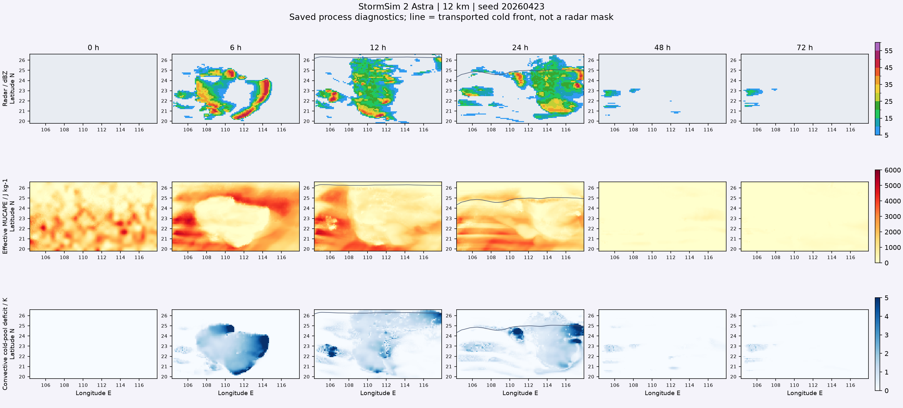

# StormSim 2 Astra / Sol

> 此页保存内核 4.0 的首版历史结果，不是当前版本的验收成绩。当前内核 4.1、缓存 5.1.0 的分段飑线、雨量和沿海地形修正见 [最新记录](SQUALL_STRUCTURE_2.md)。下文源码摘要与统计均保持原样便于追溯。

2026-10-16。产品名 **StormSim 2**，内核 `4.0.0-airmass-trigger-budget`，页面、Worker 和数据脚本缓存版本 `5.0.1`。Astra 默认网格、14 层、输出选项及 Sol 28 km 均不降配；未自动推送 GitHub。

## 六项排查与修正

1. **无组织对流过多**：旧随机扰动能在没有抬升的空气中独立提供最高数百米位移，未组织上升气流的基础覆盖率又偏大。现在随机扰动只调制实际槽前/锋面抬升或冷池前缘强迫；未组织基础覆盖率从 0.12 改为 0.015，组织化前缘仍保留有限入流质量通量，不统一削弱飑线雨核，也不禁止真实有条件的孤立对流。
2. **冷池滞留**：原恢复主要靠数小时指数衰减，强冷池几乎不参与中性残层的湍流退出。现在冷池强阶段也按层顶风切变、密度流湍流及整体 Richardson 稳定度交换热量，接近中性后同步退出厚度和动量。恢复不会清零已消耗的 CAPE；持续降水补充的头部仍可维持。
3. **锋后虚假能量**：冷空气示踪量原用浅层风输送，温湿场却按分层引导风输送，导致冷锋颜色和实际气团错位。现在对两种输送的空气质量份额差额作一致的温湿交换，并记录外部水汽收支；边界冷空气携带配套的较冷、较干廓线。均匀气团不反复重置，已形成的对流热湿异常不会每一步被复制的参考廓线抹掉。
4. **CAPE 纬向条带**：取消 `min(parcel_CAPE, latitude_ceiling)`。北侧偏稳定、偏干的限制改放进具有二维种子扰动的实际初始温湿廓线，此后随气流演变。公开有效 MUCAPE 与触发都受实际廓线及气团剩余能量账本限制，不再受固定纬度查表截顶。旧对照初始化时 51.94% 格点恰好贴着纬度上限；新版初始化为 0。
5. **版本号**：Astra / Sol 的标题、页面主标题、导航、首页提示板、切换提示和产品元数据统一为 2。协议 schema 仍为 2；内部物理版本独立编号为 4.0.0。
6. **站点雨量偏低**：确认网页原来取最近细格点，而离线核验用双线性，两者不一致；原 4×4 子格点的随机干洞还长期固定在地面，未随经过的风暴移动。现两版网页统一双线性取样；有限宽雨核纹理随实际云层引导风移动，并平滑硬边界。每个原网格每一步面积平均仍等于真实落地水通量，不造水、不统一乘雨量系数。

雨量输出间隔不是本次漏算原因：实际内核同一初值按 10 / 60 分钟输出，步数、温湿、活跃度、格点累计与子格累计逐值一致。五分钟累计直接积算落地通量，不是把瞬时雨强乘五分钟。输出较稀疏仍可能看不到短时峰值，但不会丢掉整轮累计；粗网格本身、雷达组合回波位于高空及地面雨核偏移仍会带来真实点位差异，不能保证每个站都得到同一场雨量。

## 可复核证据

- 194 项 Python 回归通过（完整 193 项通过，随后新增的六小时深冷空气回归单独通过）；包括 10 / 60 分钟输出完全一致、实际气团交换、水量守恒、CAPE 消耗、冷池、粒子数及版本隔离。
- [受控机制与雨量纹理诊断](validation/stormsim-2-operator-probes.json)：无新冷却供给的 600 m / 4 K 冷池，在该受控风场下 1 / 2 / 3 / 4 h 的最大温差约 1.44 / 0.53 / 0.26 / 0.017 K；CAPE 消耗记忆维持 800 J/kg，没有随冷池退出而恢复。
- 同一受控诊断中，深冷空气替换后继续实际积分六小时，保留地表/土壤热湿通量，有效 MUCAPE 平均约 8.3、最大约 235 J/kg，没有新触发。并未把所有锋后 CAPE 数值强制设零；浅冷楔之上的真实暖湿高架层仍允许保留能量。
- 受控雨核平流对照中，累计低于 0.5 mm 的子格点比例由静止纹理 21.19% 降到移动纹理 6.93%，两者每格都得到相同的 10 mm 平均雨量，最大水量差约 4×10⁻⁶ mm。这是纹理机制试验，不是城市降水预报技能分数。
- [高湿种子 Astra 12 km / 12 h](validation/stormsim-2-astra-moist.json)：种子 20260425，区域点位五分钟峰值 17.35 mm，活跃深对流面积峰值约 4.07%、≥40 dBZ 面积峰值约 5.01%；最大水量相对残差约 2.16×10⁻⁸。该样本没有通过压弱所有强降水来消除零散触发。
- [真实 Astra 浏览器链路](validation/stormsim-2-astra-browser.json)：Chrome + Worker + Pyodide，12 km / 3 h / 7 帧，约 84.25 秒；新物理、雨量字段、存储、自动播放及结束后回看均通过，水量相对残差约 4.19×10⁻¹⁰。不是浏览器完整 72 h 性能成绩。
- WebKit / iPhone 13 视口真实 Astra 首帧已存入 IndexedDB，计算推进至 2.5% 后主动停止，无初始化错误；不等于实体 iPhone 完整 72 h 测试。
- 界面回归覆盖双版本入口、ETA、按钮锁定、取消与全新种子、手机布局、32 站选择、触屏/键盘、细格点边缘与降水读数。Sol 只作短网页兼容检查，不代替 Astra 物理过程验收。

### 全域 Astra 整轮与边界情况

[Astra 12 km / 72 h](validation/stormsim-2-astra-72h.json) 使用种子 20260423；最终与高湿案例、机制诊断及真实网页的核心源码摘要均为：

`d85186cfce1f62ff224bdef0be00503d75d74245b46cb375bfd65f1bb44f328d`

整轮活跃深对流面积峰值约 4.62%，≥40 dBZ 面积峰值约 4.46%；区域近五分钟峰值 19.25 mm，最大水量相对残差约 6.43×10⁻⁷。第 48–72 小时不再产生强回波或重雨复发；第 72 小时冷侧有效 MUCAPE 第 95 百分位约 127 J/kg，活跃冷池约占全域 0.49%。这些不是所有种子通用的气象阈值或预报技能。

**严格零触发检查并未通过**：第 57 / 58 小时各有一个格点（0.013%）出现弱触发，最大雨强分别约 1.62 / 2.44 mm/h，无 ≥40 dBZ 回波，也没有形成 `activity > 0.15` 的持续活跃对流。该弱午后响应未被掩膜删除。[原严格检查记录](validation/stormsim-2-strict-zero-diagnostic.json) 和 [最终分项验收](validation/stormsim-2-acceptance.json) 均保留该事实：后者针对本轮大范围/强对流复发问题，而不要求所有合法浅对流一概为零。锋后高架层和日间加热仍可产生正 CAPE；例如第 60 小时冷侧 CAPE 第 95 百分位约 937 J/kg，但没有触发强对流，随后继续回落。不能把“CAPE 非零”与“必然有强对流”画等号。

下面绘制的是已经保存的实际场，不另行积分；后期弱环境降水允许保留，冷池轮廓没有加回公开地图。

旧 1.2 成绩不能冒充本版。未恢复此前取消的默认 6 km 全过程验证，所有统计只代表所测种子和配置，不保证所有随机过程都产生相同飑线。Sol 的 [3 h 真实网页兼容检查](validation/stormsim-2-sol-browser-short.json) 通过，不据此推算或宣称新版 72 h 少于五分钟。

## 局限与机制依据

物质交换属于降阶参考空气质量闭合，水汽通量明确记入外部收支，不是完整三维原始方程模式。冷空气温湿差、夹卷系数、亚格点雨核宽度和覆盖率都是本项目实验参数，未以实况重新标定；子格点插值与雨核纹理不会把动力分辨率提高到 1 km。真实锋区高架对流不能仅因地面冷空气到达而一概禁止。

冷池恢复中夹卷与地表热通量的作用参考 [Cold Pools and Their Influence on the Tropical Marine Boundary Layer](https://journals.ametsoc.org/abstract/journals/atsc/74/4/jas-d-16-0264.1.xml)；对流触发需克服抑制、而非只有 CAPE，参考 [ECMWF 对流说明](https://confluence.ecmwf.int/spaces/FUG/pages/673550511/Section%2B2A.1.5.4%2BConvective%2Bcloud%2Bprocesses%2Band%2Bprecipitation)。这些来源提供机制背景，不为本项目数值系数或预报精度背书。

本地使用 `development/launchers/启动本地预览.command` 或 `python3 -m simulation.preview`，不要双击 HTML 以 `file://` 打开。刷新网页并开始全新一轮才使用新内核；旧结果不会被追溯改写。上传完整项目，保留根目录 `.nojekyll`，尤其不要遗漏 `simulation/precipitation.py`、`simulation/synoptic.py` 和 `assets/scripts/simulation-data.js`。
