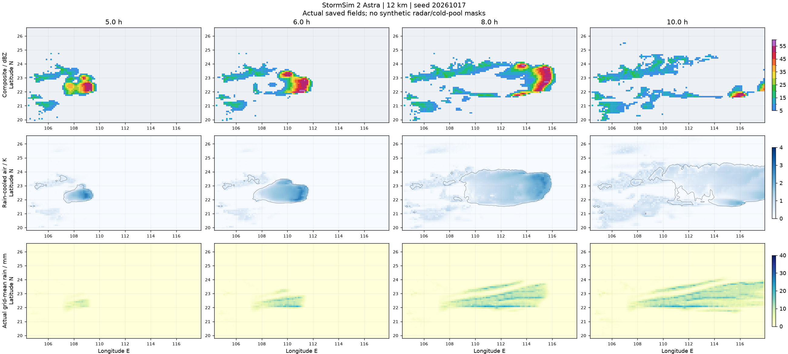
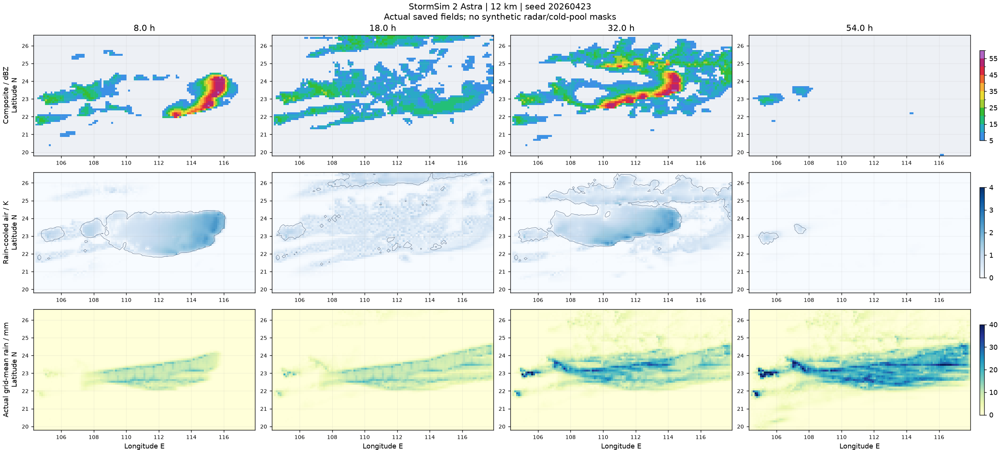

# StormSim 2：西风、冷锋时序与暖区起生修复

此为 `4.4.0` 历史验证。当前改动与证据见 [回波与锋面形状修复](ECHO_FRONT_2.md)。

内核 `4.4.0-westerly-warm-sector`，页面/Worker 缓存 `5.4.0`。产品名不变，仍为 StormSim 2 Astra / Sol。默认网格、层数、地图、站点、降水守恒取样与播放方式不变。

## 原因与修复

- **500 hPa 过度偏向北移动**：旧背景偏南风与孟加拉湾槽的偏南扰动叠加，初始来向常为 226°–247°，单体很容易向东北方离开区域。现在用西风主导、弱偏南的背景，并减小远处槽的经向扰动；不是旋转地图箭头。风场仍随种子、时刻、空间和动力反馈变化。气象风向采用来向：247.5°–270° 对应西南偏西至西风，而箭头表示向东至东偏北移动。
- **冷锋过早截断暖区**：越岭前基础速度由 2.15 改为 1.45 m/s，越岭后的增速项由 5.5 改为 6.5 m/s，仍乘实际情景冷空气强度、区域型及波动；南岭位置来自 DEM，不是固定时间开关。锋前风场影响尺度从 130 缩到 70 km，避免在锋面远未到来时就切断南侧低层入流。广东、广西段均持续推进，保留种子控制的先后差异，没有恢复静止锋。
- **弱冷却层误封起生**：旧判据只要冷层厚超过 100 m 就禁止独立起生，甚至 0.3 K / 110 m 的弱雨冷却层也会被当成成熟飑后冷池。现在要求冷却小于 1 K 且整层负浮力功 `g·Q/295 < 10 J/kg`，不再单独用厚度判断。深冷空气比例小于 20%、耗能记忆低于容量的 35% 的限制仍保留；局地 CAPE、CIN、LFC 和实际抬升仍要独立过关。没有清空冷池、补回 CAPE、重置水汽或指定雨强。
- **起生窗过早关闭/过迟关闭**：仅有组织度不再代表已形成母系统，必须有实际降水、活跃对流和暖侧冷池前缘再生。同时统计对象是窄的再生头部，而非整片风暴，关闭阈值改为 1000 km²；避免反过来因要求 3000 km² 再生头而让旧起生区在母系统远离后持续激发。首次有限辐合持续 6–8 小时、扰动幅度 10–12 m/s，并不规定飑线寿命或速度。形成可自行再生的母系统后关闭独立起生；次日重新评估实际暖区，不锁死全程。

这些是降阶情景模型的参数化，不等同于完整三维气象模式或真实天气预报；阈值并不是普适实况结论。

## 本轮验证记录

最终源码 SHA-256：`53664f9dc67fa1aec2864f9bac488d5924868c40a3a3ebd0c2d96871183fdb13`。验证限定为 Astra 12 km，未降低或更改生产默认精度；不以 Sol 代替 Astra 验证，也不保证所有随机种子都产生相同天气。

历史 `daily-*`、`bay-*` 及临时候选结果不作为本轮最终源码的证据。最终原始数据统一采用 `validation/stormsim-2-westerly-*` 前缀。

- 221 项 Python 回归通过，覆盖 500 hPa 实际来向、24 h 冷锋位置、远锋前入流、浅弱冷却层误封、耗能尾迹不能冒充新空气、起生窗关闭、降水守恒与长期冰晶数稳定性等。
- 真实 Chrome / Astra / 12 km / 3 h / 7 帧验证完成，112.274 秒，最终源码 SHA 一致，水量相对残差 `9.42e-12`；Worker/WASM、IndexedDB、开始锁定、自动播放及结束回放通过。不是浏览器 72 h 耗时证明。
- 真实 WebKit / iPhone 视口以最终源码保存首帧并推进至约 1.70%，没有脚本异常；不是实体 iPhone 整轮验证。
- 两版页面交互与数据解码检查通过，`.nojekyll` 仍在本地根目录。

| Astra 12 km 样例 | 时长 | 首次成片强对流采样 | 格点雨强峰值 | 域内细网格五分钟雨量峰值 | 域内细网格累计峰值 |
| --- | --- | --- | --- | --- | --- |
| 20261020 / 3 月 | 10 h | 5 h | 70.09 mm/h | 16.68 mm | 34.75 mm |
| 20261018 / 4 月，偏干 | 10 h | 4.5 h | 72.31 mm/h | 17.59 mm | 41.84 mm |
| 20261017 / 5 月 | 12 h | 4.5 h | 101.51 mm/h | 31.44 mm | 57.13 mm |
| 20260423 / 4 月连续过程 | 72 h | 4.5 h；次日 29 h | 88.52 mm/h | 20.51 mm | 83.03 mm |

以上为真实落地降水积分，不是通过加亮雷达或统一乘雨量获得。峰值是域内最大值，不表示每个测站均达到同样雨量。五分钟峰值属于守恒区内的细尺度雨核取样，并不等同于 12 km 网格解析到相同空间精度。半小时采样的强对流诊断要求同时有 ≥40 dBZ、活动度 >0.1、实际雨强 ≥5 mm/h。5 月样例可维持至约 10.5 h，偏干样例至 10 h 仍有强对流。各分量均保留，弱连接断裂不被删除以凑出一条连通色块。



72 h 连续样例（20260423）：首轮在约 4.5 h 出现成片强对流；18–24 h 的采样均无新触发及强对流。24 h 冷锋仍约位于 25.69–25.74°N，西部暖区保留 459 个符合资格且可用 CAPE >300 J/kg 的网格列，其中可用 CAPE 中位数约 1812 J/kg。次日起生中心改为约 106.88°E / 23.69°N，26 h 已有新对流和降水，29–35 h 持续有成片强对流采样，32.5 h 格点雨强峰值约 88.52 mm/h。36 h 冷锋约在 23.79–24.93°N，之后继续南下；没有在首轮尾迹里重置能量制造第二轮。

第三天在西南边界残留暖区（起生中心约 104.65°E / 20.45°N）仍有短促局地对流，不能宣称第三天全程零触发；它没有形成新的成熟飑线，随后随冷空气进入而消失。54 h 广东锋后区域（110–117°E、21.5–24.5°N，深冷空气比例 >80%）可用 MUCAPE 最高约 72 J/kg、无活跃深对流；这个数不是对 CAPE 人为设置的上限。

最终 72 h 已完成，最大水量相对残差为 `1.83e-7`，峰值阵风为 30.02 m/s，实际 500 hPa 来向采样范围约为 254.40°–269.51°。长期冰水/冰晶数、温度和其他积分状态均通过逐步有限性检查；冷锋最终移出南边界。其余三个独立种子也形成了成片对流与实际强降雨，不仅测试一个有利样例。

[最终验收 JSON](validation/stormsim-2-westerly-acceptance.json) 的 15 项针对性检查通过，所有原始过程、浏览器及 WebKit 证据均对应上面的最终源码 SHA。复核命令：

```sh
python -m simulation.accept_westerly \
  --process simulation/validation/stormsim-2-westerly-astra-72h.json \
    simulation/validation/stormsim-2-westerly-astra17.json \
    simulation/validation/stormsim-2-westerly-astra18.json \
    simulation/validation/stormsim-2-westerly-march.json \
  --browser simulation/validation/stormsim-2-westerly-browser.json \
  --safari simulation/validation/stormsim-2-westerly-safari.json \
  --output /tmp/stormsim-westerly-acceptance.json
```

该命令只读取已保存结果，不会再跑一轮模拟。严格单一连通回波并非本验收声称已证明的性质；原始数据保留了分段与弱连接。测试不覆盖每个随机种子，也不声称默认 6 km 全过程已经验证。



## 更新部署

一起上传 `simulation/`、`assets/`、`simulator.html` 和 `simulator-sol.html`，保留根目录 `.nojekyll`。前端、Worker 均已更新缓存标记，Python 源文件仍使用重新验证的请求方式。已有模拟存档不会因更新代码而重算；验收应开始新一轮，不回放旧天气。
